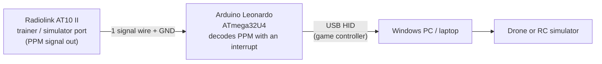

# PPM2USB: build your own RC simulator dongle


**Turn your RC transmitter's PPM trainer/simulator output into a USB game controller using a ATmega32U4 based development board such as Arduino Pro Micro or Leonardo and a few simple wire connections.**

Commercial "RC flight simulator cables" do this one job: they read the transmitter's trainer/PPM output and present it to the PC as a controller. You can build the same thing yourself, understand every step, and adapt it to your own needs.

> **Compatibility notice.** This project has been developed and tested **only with the Radiolink AT10 II**. Other transmitters may use different PPM voltage levels, polarity, frame timing or connector pinouts. See [Compatibility](#compatibility) and please report results for other radios.

## Demo
https://github.com/user-attachments/assets/2820df99-42f7-46e2-8c88-e9992d0a29b9

*Video: FPV Freerider demo video.*


---

## Table of contents

1. [Why build this?](#why-build-this)
2. [How it works](#how-it-works)
3. [What is PPM?](#what-is-ppm)
4. [Decoding PPM on the Leonardo](#decoding-ppm-on-the-leonardo)
5. [From channels to a USB game controller](#from-channels-to-a-usb-game-controller)
6. [Why you can't use an Arduino Uno or Nano directly](#why-you-cant-use-an-arduino-uno-or-nano-directly)
7. [Hardware](#hardware)
8. [Wiring](#wiring)
9. [Step-by-step build](#step-by-step-build)
10. [Using it in a simulator](#using-it-in-a-simulator)
11. [Calibration and channel mapping](#calibration-and-channel-mapping)
12. [Troubleshooting](#troubleshooting)
13. [Compatibility](#compatibility)
14. [Verification log](#verification-log)
15. [Limitations and roadmap](#limitations-and-roadmap)
16. [Repository layout](#repository-layout)
17. [Contributing](#contributing)
18. [Built with Claude](#built-with-claude)
19. [License and disclaimer](#license-and-disclaimer)

---

## Why build this?


Ready-made USB simulator cables are available, but they can be relatively expensive for a simple interface. For comparison, a 22-in-1 RC flight simulator cable was listed at ₹1,799 (MRP ₹2,600) on Amazon India when checked in October 2026. Prices may change.

This DIY project provides an alternative using an Arduino Leonardo and a few wires, while helping you understand PPM signal decoding and USB HID game-controller programming.

- how RC transmitters encode channel data (PPM),
- how to measure and decode a timing-based signal with hardware interrupts,
- how a microcontroller becomes a USB HID device (a game controller) with no driver on the PC.

| | Commercial simulator cable | This DIY interface |
|---|---|---|
| Setup | Plug in, pick the right adapter | Wire 2 signals, upload a sketch |
| Cost | Product price (see listing above) | Cost of a Leonardo-class board and a few wires (check current prices) |
| Supported radios | Many (per product) | **AT10 II only, tested**; others unverified |
| Transparency | Closed | Open firmware, fully documented |
| Customisable | No | Channel mapping, inversion, calibration, extra axes or buttons |

This is not meant to say commercial cables are bad. If you only want to fly, a cable that is known to work with your simulator is the simplest route. This repo is for people who want to build and learn.

## How it works



1. The transmitter outputs all of its channels as **one PPM signal** on the trainer/simulator port.
2. The Leonardo measures the time between pulses with a **hardware interrupt** and converts those times into channel values (1000-2000 µs).
3. The Leonardo enumerates on USB as a **standard HID game controller** and reports the channels as joystick axes.
4. The PC and simulator treat it like any joystick. No custom driver is needed.

## What is PPM?

**PPM (Pulse Position Modulation)**, in the RC hobby, means *all channels of a transmitter multiplexed onto a single wire*. Instead of one wire per channel, the transmitter sends a repeating **frame** of short pulses. The **time between consecutive pulses** encodes one channel's value.

```
       ┌─┐        ┌─┐          ┌─┐      ┌─┐                  ┌─┐
  ─────┘ └────────┘ └──────────┘ └──────┘ └──────────────────┘ └──────
       |<─ CH1 ──>|<──  CH2 ──>|<─ CH3 ─>|<──── sync gap ────>|
         1.0 ms       1.5 ms       1.2 ms        ≥ 3 ms
                        (illustration, not to scale)
```

Key facts:

| Property | Typical value |
|---|---|
| Channel value | **1000 µs** (minimum) to **2000 µs** (maximum), **1500 µs** at centre |
| Pulse width itself | A fixed, short pulse (a few hundred µs). Only the *spacing* carries data |
| Sync gap | A long interval (several ms) that fills the rest of the frame and marks "frame start" |
| Frame length | Commonly around 20-22.5 ms, so roughly 45-50 frames per second |
| Channels per frame | Varies by transmitter. **Measure yours** with `ppm_test.ino` |

Because the sync gap is longer than any channel interval, a receiver can tell where a frame begins: *any interval longer than about 3 ms means "new frame"*.

Real transmitters often don't hit exactly 1000-2000 µs. Your sticks might span 1100-1900 µs, for example. That is why this project includes a calibration step.

## Decoding PPM on the Leonardo

The decoder lives in an **interrupt service routine (ISR)** that runs on every rising edge of the signal on pin D3 (INT0):

```cpp
void ppmISR() {
  uint32_t now = micros();
  uint32_t d   = now - lastEdge;   // time between rising edges
  lastEdge = now;

  if (d > SYNC_US) {               // sync gap -> previous frame complete
    if (workIdx >= 4) {            // sanity check: at least 4 channels
      for (uint8_t i = 0; i < workIdx; i++) ready[i] = work[i];
      readyCount = workIdx;
    }
    workIdx = 0;
  } else if (d >= MIN_PULSE_US && d <= MAX_PULSE_US && workIdx < MAX_CH) {
    work[workIdx++] = d;           // channel value in microseconds
  }
}
```

Design choices worth knowing:

- **Edge-to-edge timing.** Measuring from rising edge to rising edge makes the result independent of the (fixed) pulse width. If your signal's polarity is inverted, use `FALLING` instead of `RISING`.
- **Resolution.** On a 16 MHz AVR, `micros()` has **4 µs resolution**. That is about 0.4% of the 1000 µs range, which is more than enough for a simulator.
- **Double buffering.** The ISR writes into `work[]` and only copies a *complete* frame into `ready[]` at the sync gap. The main loop therefore never reads a half-updated frame.
- **Atomic reads.** The AVR is an 8-bit CPU, so reading a 16-bit variable is not atomic. The main loop disables interrupts briefly while copying the frame.
- **Noise filtering.** Intervals outside 800-2200 µs (other than the sync gap) are ignored.
- **Why D3?** On the Leonardo, only pins 0, 1, 2, 3 and 7 support external interrupts.

## From channels to a USB game controller

The ATmega32U4 has a **USB controller built into the chip**, so your sketch decides what kind of USB device the board is. Using the [ArduinoJoystickLibrary](https://github.com/MHeironimus/ArduinoJoystickLibrary), the Leonardo declares itself as a **HID (Human Interface Device) game controller** with 8 axes (X, Y, Z, Rx, Ry, Rz, Rudder, Throttle).

- HID is the same class used by keyboards, mice and joysticks. Windows includes a driver for it, so **no driver installation is needed**.
- The sketch converts each channel from **1000-2000 µs** to **0-1000** (after calibration limits are applied) and sends a report about **100 times per second**.
- Windows lists it under *Set up USB game controllers* (`joy.cpl`), and simulators can map it like any other joystick.

The first 8 channels are exposed. The mapping from PPM channel to USB axis is configurable in the sketch (`CH_MAP`), and each axis can be inverted (`INVERT`).

## Why you can't use an Arduino Uno or Nano directly

The Leonardo works because its main microcontroller **has USB built in**. The Uno and Nano do not.

| Board | Main MCU | How USB is connected | Can appear as a game controller directly? |
|---|---|---|---|
| **Leonardo** | ATmega32U4 | **Native USB on the main chip** | **Yes** |
| Pro Micro / Micro | ATmega32U4 | Native USB | Yes (same chip; not tested here) |
| Uno R3 | ATmega328P | Separate USB-to-serial chip (ATmega16U2 on genuine boards, CH340 on many clones) | No, not without modification |
| Nano | ATmega328P | Separate USB-to-serial chip (FT232 or CH340) | No |

The ATmega328P has no USB peripheral. On an Uno or Nano the USB port connects to a **second chip that only acts as a USB-to-serial bridge**. The PC therefore sees a **COM port**, not a joystick, and nothing you write in your sketch can change what the bridge chip announces to the PC.

### What you would have to change to use an Uno or Nano

These are known approaches. **They are not implemented or tested in this repo.**

1. **Software bridge (works on any Uno/Nano, no hardware changes).**
   The Uno/Nano decodes PPM and sends the channel values over serial. A program on the PC reads the COM port and feeds a **virtual joystick driver** such as vJoy (Windows). This works, but you need a driver and a script running on the PC, and it adds a little latency.
2. **Reflash the USB chip of an Uno R3.**
   Projects like UnoJoy and HoodLoader2 replace the firmware of the ATmega16U2 so the Uno can act as a HID device. This applies to Uno R3 boards that really have a reflashable 16U2. It does **not** work on boards using a CH340 (including many clones) or on the Nano, because those chips cannot be reprogrammed. You also have to switch the firmware back to upload normal sketches.
3. **Software USB (V-USB) on the ATmega328P.**
   The 328P can bit-bang USB in firmware, but it needs specific clock speeds, extra components and careful wiring. It is not recommended for a first project.

Using a board with native USB (Leonardo, Pro Micro, Teensy, RP2040, ESP32-S2/S3) avoids all of this.

## Hardware

| Qty | Part | Notes |
|---|---|---|
| 1 | **Arduino Leonardo** (or compatible ATmega32U4 board) | Needs a USB data cable |
| 1 | Radiolink **AT10 II** transmitter | The only tested radio |
| 1 | Connector or cable that mates with the transmitter's trainer/simulator port | Check the port's size and pin count against your plug |
| 1 | 1 kΩ resistor (recommended) | Series protection on the signal line |
| - | Jumper wires, optional breadboard | |
| 1 | Multimeter (strongly recommended) | To verify pins and voltage before connecting |

## Wiring


The AT10 II manual lists these signals for the trainer/simulator port:

| Port signal | Function (per the manual) | Connect to Leonardo? |
|---|---|---|
| **OUT** | PPM signal out | **Yes**, to D3 (through a 1 kΩ resistor) |
| **GND** | Ground | **Yes**, to GND |
| **VCC** | Voltage output, **7.4-15 V** | **NO. Never connect this to the Leonardo** |
| IN | RSSI signal input | No |
| NC | No output | No |

```
AT10 II trainer/simulator port            Arduino Leonardo
------------------------------            ----------------
OUT  (PPM signal out)  ──[ 1 kΩ ]──────►  D3  (INT0)
GND                    ─────────────────►  GND
VCC  (7.4-15 V)        ✗  not connected
IN   (RSSI input)      ✗  not connected
NC                     ✗  not connected
```

> **⚠️ Warning: the port's VCC pin carries the transmitter battery voltage (7.4-15 V per the manual).** Connecting it to a Leonardo I/O pin will damage the board and may feed voltage back into your USB port. Insulate the unused pins, and make sure a wire can't touch two pins.

Before connecting anything:

1. **Identify the pins with a multimeter.** Use the manual's pinout diagram for the physical positions, then confirm GND by continuity to the transmitter's negative terminal, and check VCC and OUT with the transmitter on.
2. **Measure the PPM level.** The Leonardo is a 5 V device. A 3.3 V or 5 V PPM signal is fine. **If you measure more than 5 V, do not connect it directly.** Use a voltage divider.
3. **Check the manual for any menu setting** that enables PPM output on the trainer/simulator port.

## Step-by-step build

### 1. Set up the Arduino IDE

- Install the [Arduino IDE](https://www.arduino.cc/en/software).
- Select **Tools → Board → Arduino Leonardo**.
- Download the ArduinoJoystickLibrary by Matthew Heironimus using the direct ZIP [download link](https://github.com/MHeironimus/ArduinoJoystickLibrary/archive/refs/heads/master.zip).
- After downloading, open Arduino IDE and select Sketch → Include Library → Add .ZIP Library.

### 2. Test the PPM signal first

Upload [`firmware/ppm_test/ppm_test.ino`](firmware/ppm_test/ppm_test.ino) and open the Serial Monitor at **115200 baud**. Switch the transmitter on and move the sticks.

You should see something like this (example format; your values will differ):

```
fps=47  ch=8  | 1500 1500 1000 1500 1500 1500 1500 1500
```

Check:

- a stable **channel count**,
- a frame rate of roughly 45-50 fps (this depends on your transmitter),
- values that sweep between roughly 1000 and 2000 as you move the sticks.

Every 5 seconds the sketch also prints the **min and max seen for each channel**. Move every stick and switch to its limits, then note these numbers for calibration.

If you see nothing, or values that jump randomly, see [Troubleshooting](#troubleshooting).

### 3. Upload the joystick firmware

Edit the settings at the top of [`firmware/ppm_usb_joystick/ppm_usb_joystick.ino`](firmware/ppm_usb_joystick/ppm_usb_joystick.ino):

```cpp
#define PPM_MIN_US     1000   // your measured minimum
#define PPM_MAX_US     2000   // your measured maximum
const uint8_t CH_MAP[NUM_AXES] = {0, 1, 2, 3, 4, 5, 6, 7};
const bool    INVERT[NUM_AXES] = {false, false, false, false, false, false, false, false};
```

Upload it. The Leonardo will now appear as a game controller.

### 4. Verify in Windows

1. Press **Win + R**, type `joy.cpl`, and press Enter.
2. Select the device, then **Properties**.
3. Move the sticks and switches. Each should move the matching axis from end to end.

A browser-based "gamepad tester" page is a good second check.

## Using it in a simulator

Any simulator that accepts a generic USB joystick should work. In each one you will assign throttle, yaw, pitch and roll to axes, calibrate, and map your arm switch.

| Simulator | Cost | Status with this project |
|---|---|---|
| Nexus-FPV by webXOS | Browser based FPV Quadcopter SIM | Verfied & Tested |
| FPV freerider by John Holmvall | Computer App | Verified & tested |
| Orqa FPV.SkyDive | Free-to-play on Steam | Not yet verified. Please report |
| Velocidrone | Paid | Not yet verified |
| Liftoff | Paid | Not yet verified |
| RealFlight / Phoenix RC | Paid | Not yet verified |

Tips:

- Run the `joy.cpl` check first, so any later problem is clearly a mapping problem rather than a signal problem.
- Use the simulator's **calibration** wizard and set deadzone and expo to zero while testing.
- Different transmitters use different channel orders (commonly AETR or TAER). You can remap in the simulator or with `CH_MAP` in the sketch.

## Calibration and channel mapping

| Symptom | Fix |
|---|---|
| Stick doesn't reach 0 or 1000 in `joy.cpl` | Set `PPM_MIN_US` / `PPM_MAX_US` to the min/max reported by `ppm_test.ino` |
| An axis moves the wrong way | Set that entry in `INVERT` to `true`, or invert it in the simulator |
| Stick controls the wrong function | Change `CH_MAP`, or remap in the simulator |
| Need more than 8 channels | Increase `NUM_AXES` and add buttons or axes (see [roadmap](#limitations-and-roadmap)) |

## Troubleshooting

| Problem | Things to check |
|---|---|
| Serial Monitor shows nothing | Select the right COM port. The test sketch waits up to 3 s for the USB serial connection |
| `ch=0` or no values | Transmitter on? PPM output enabled for the port? Signal wire on D3 and ground shared? Signal level measured? |
| Values jump randomly | Poor ground, floating signal, or wrong edge. Try `FALLING`. Keep wires short |
| All values around 1500 | Frame is decoded, but the sticks aren't moving or the wrong channel is being read. Move sticks and watch which channel changes |
| Signal looks floating or weak | Some outputs are open-collector/open-drain. Measure it first. A pull-up (`INPUT_PULLUP`) may be needed in that case |
| Windows doesn't list a controller | Confirm the *joystick* sketch uploaded (not the test sketch), the USB cable carries data, and the library is installed |
| Can't upload to the Leonardo | Double-tap the reset button to enter the bootloader, then upload right away |
| Simulator doesn't see the device | Start the simulator *after* plugging in the Leonardo, and check the simulator's controller list |

## Compatibility

| Transmitter | Status |
|---|---|
| **Radiolink AT10 II** | **Developed and tested** |
| Any other radio with a PPM trainer/simulator output | Unverified. PPM is common, but voltage level, polarity, frame timing and connector pinout differ. Measure before connecting |

| Board | Status |
|---|---|
| **Arduino Leonardo** | **Target board** |
| Pro Micro / Micro (ATmega32U4) | Should work (same chip), untested |
| Arduino Uno / Nano | Does **not** work directly. See [the explanation above](#why-you-cant-use-an-arduino-uno-or-nano-directly) |
| RP2040, ESP32-S2/S3, Teensy | Native USB, so possible with a different HID library. Not part of this repo yet |

If you try another transmitter or board, please open an issue with your results and your measurements from `ppm_test.ino`.

## Verification log


| Item | Result |
|---|---|
| Arduino-IDE version | 2.3.10 |
| Arduino Joystick Library by Matthew Heironimus version | v2.1.1 |
| Transmitter | Radiolink AT10 II |
| Radio Controller Firmware version | v1.4.6a (A12s) |
| PPM voltage at OUT pin | not tested |
| Signal polarity (RISING or FALLING works) | not tested |
| Channels detected | 4 (radiolink_ppm.ino) |
| Frame rate | not tested |
| Measured min / max (µs) | ___ / ___  (not tested) |
| `joy.cpl` shows all axes moving | ☑ |
| Simulator tested and result | only tetsted with nexus FPV simulator and FPV freerider simulator |

## Limitations and roadmap

Current limitations:

- Only the first 8 channels are exposed as axes.
- On signal loss the last report is simply held (no failsafe values).
- Calibration constants are set in the source code and are the same for all channels.

Ideas for later:
- [ ] Add wireless operation using two nRF24L01 modules: an Arduino Nano reads PPM from the Radiolink transmitter and sends the channel data wirelessly to an nRF24L01 receiver connected to the Arduino Leonardo, which acts as the USB game controller
- [ ] Expose channels 9+ as extra axes, or convert switch channels to buttons
- [ ] Port to ESP32-S3 (native USB) with a live channel display on its LCD
- [ ] Compatibility notes for other transmitter

## Repository layout

```
.
├── README.md
├── LICENSE
└── firmware/
    ├── ppm_test/
    │   └── ppm_test.ino              # step 1: check the PPM signal
    |── ppm_usb_joystick/
    |   └── ppm_usb_joystick.ino      # step 2: the USB joystick firmware for testing
    └── radiolink_ppm/
        └── radiolink_ppm.ino         # upload plug and play : the USB joystick firmware for Radiolink at10ii RC

```

## Contributing

Issues and pull requests are welcome, especially:

- test results for other transmitters, with `ppm_test.ino` output,
- ports to other native-USB boards,
- improvements to calibration, failsafe and documentation.


## License and disclaimer

Released under the [MIT License](LICENSE).

This is a hobby project provided **as is, without warranty**. Wiring a transmitter to a microcontroller can damage equipment if done incorrectly, so you do this at your own risk. This project is **not affiliated with or endorsed by** Radiolink, Arduino, Orqa or any simulator publisher. Product and company names are used for identification only and belong to their respective owners.
